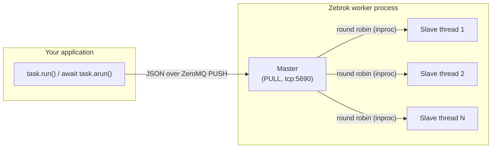

<div align="center">

# Zebrok

**A brokerless task queue for Python, built on ZeroMQ.**

Move slow work out of your request path and into separate workers,
without running Redis, RabbitMQ, or any other server.

[](https://github.com/kaypee90/zebrok/actions/workflows/python-app.yml)
[](https://www.python.org/)
[](https://opensource.org/licenses/MIT)
[](https://hub.docker.com/r/kaypee90/zebrok)

[Quick start](#quick-start) · [Where it fits](#where-zebrok-fits) · [Comparison](#how-it-compares) · [Deployment](#deployment) · [Configuration](#configuration)

</div>

---

```python
from zebrok import Task

@Task
def send_welcome_email(user_id, template="default"):
    ...

send_welcome_email.run(42, template="onboarding")   # returns immediately; a worker does the work
```

## Why Zebrok?

Most Python task queues need a message broker: Celery with RabbitMQ or Redis, RQ with Redis, and so on.
That's one more service to deploy, secure, monitor and pay for. Zebrok sends tasks **straight from
your app to your workers** over ZeroMQ sockets. You get a worker process with nothing in between.

- **🪶 No infrastructure.** `pip install`, start a worker, and you're done. The only dependency is `pyzmq`.
- **⚡ Fast and lightweight.** ZeroMQ is a low-latency messaging library, so there's no broker hop and no extra service to run.
- **🧵 Separate workers.** Tasks run outside your web process, in another process, container or machine.
- **🔁 asyncio-friendly.** `await task.arun(...)` publishes from FastAPI, aiohttp and friends without blocking the event loop. `async def` tasks are supported too.
- **🛟 Fails loudly, not silently.** If no worker is reachable, `run()` raises `ZebrokPublishError` within a timeout instead of hanging.
- **🛑 Graceful shutdown.** `SIGTERM` and Ctrl+C let running tasks finish, so rolling deploys on Docker or Kubernetes stay clean.
- **🧯 Resilient workers.** A crashing task (even one calling `sys.exit()`) or a malformed message is logged and the worker keeps going. Optional automatic retries.
- **🔒 Safe by default.** Workers only execute functions explicitly marked with `@Task`.

## Where Zebrok fits

Zebrok sits between running work **inside** your web process and running a **full broker-backed** queue.


### ✅ Great for

- **Fire-and-forget side effects**: notifications, webhooks, analytics and audit events.
- **Work that's cheap to redo**: thumbnails, cache warming, search re-indexing, report generation.
- **Small and medium services, internal tools and side projects** where a broker would be the biggest piece of infrastructure.
- **Edge, embedded, on-prem or air-gapped deployments** where every extra service is a cost.
- **Growing out of `BackgroundTasks`**: keep slow work from competing with requests, without adopting Celery.

### ⚠️ Not the right tool (yet) for

- **Work that must never be lost**, such as payments, orders and transactional emails. Queued tasks live in worker memory, so a crashed worker loses what it hadn't started yet. Use a durable queue.
- **Needing return values or task status.** Tasks are fire-and-forget.
- **Scheduled or periodic jobs.** There's no built-in scheduler; pair it with cron, or use Celery beat or Huey.
- **CPU-bound parallelism inside one worker.** Slave workers are threads. Scale CPU-heavy work by running more worker replicas.

## How it compares

| | **Zebrok** | FastAPI `BackgroundTasks` | Celery | RQ | Dramatiq | Huey | arq |
|---|:---:|:---:|:---:|:---:|:---:|:---:|:---:|
| Extra infrastructure | **None** | None | RabbitMQ / Redis / SQS | Redis | RabbitMQ / Redis | Redis or SQLite file | Redis |
| Runs outside the web process | ✅ | ❌ | ✅ | ✅ | ✅ | ✅ | ✅ |
| Queue survives a worker crash | ❌ | ❌ | ✅ | ✅ | ✅ | ✅ | ✅ |
| Task results / status | ❌ | ❌ | ✅ | ✅ | ✅ | ✅ | ✅ |
| Scheduled / periodic tasks | ❌ | ❌ | ✅ | ✅ | ➖ | ✅ | ✅ |
| Retries | ✅ | ❌ | ✅ | ✅ | ✅ | ✅ | ✅ |
| Native asyncio publishing | ✅ | ✅ | ❌ | ❌ | ❌ | ❌ | ✅ |
| Setup effort | `pip install` | Built in | High | Low | Medium | Low | Low |

➖ = available through extensions. This is a summary to help you choose; check each project's documentation for details.

**Rule of thumb:** if you already run Redis or RabbitMQ, or you can't afford to lose a task, use a broker-backed queue.
If you want real background workers and adding a broker isn't worth it, use Zebrok.

## How it works



1. Calling `task.run(*args, **kwargs)` serializes the call to JSON and pushes it to the worker's TCP port.
2. The **master** receives it. With `number_of_slaves=0` it runs the task itself. Otherwise it hands the task to its
   **slave threads** in round-robin order, over in-process sockets.
3. The task function runs in the worker. Any exceptions are logged and retried if you configured retries.

Delivery is **at-most-once**: a task runs once, or not at all if its worker dies before running it.

## Quick start

### 1. Install

```sh
pip install git+https://github.com/kaypee90/zebrok.git#egg=zebrok
```

Requires Python 3.10+.

### 2. Define tasks (`tasks.py`)

```python
from zebrok import Task

@Task
def resize_image(path, width=800):
    ...

@Task
async def notify(url, payload):     # async tasks work too
    ...
```

### 3. Start a worker (`start.py`)

```python
from zebrok import WorkerInitializer
from tasks import resize_image

worker = WorkerInitializer(
    number_of_slaves=3,      # worker threads; 0 = run tasks in the main worker
    auto_discover=True,      # also find @Task functions in tasks.py
    max_retries=2,           # retry a task that raises
    retry_delay=1.0,         # seconds between attempts
)
worker.register_task(resize_image)
worker.start()               # blocks until Ctrl+C / SIGTERM
```

```sh
python start.py
```

### 4. Send work from your app

```python
from tasks import resize_image

resize_image.run("uploads/cat.png", width=400)
```

From async code:

```python
@app.post("/upload")
async def upload(...):
    await resize_image.arun("uploads/cat.png", width=400)
    return {"status": "queued"}
```

Arguments must be JSON serializable. If no worker answers within `ZEBROK_PUBLISH_TIMEOUT_MS`,
`run()` raises `zebrok.ZebrokPublishError`, so you can return an error or fall back.

> 💡 See the [sample FastAPI project using Zebrok](https://github.com/kaypee90/sample-zebrok-1).

### Running a worker inside another program

```python
worker.start(block=False)    # runs in background threads
...
worker.stop()                # running tasks finish, then it returns
```

## Deployment

### Docker Compose (try the examples)

```sh
git clone git@github.com:kaypee90/zebrok.git && cd zebrok
docker-compose up
```

In one terminal, start the worker:

```sh
docker exec -it <worker-container-id> python examples/start.py
```

In another, queue some jobs:

```sh
docker exec -it <publisher-container-id> python examples/client.py
```

<details>
<summary>Expected worker output</summary>

```
2026-11-03 20:09:59 - zebrok.discovery - INFO - ** 2 ZEBROK TASKS DISCOVERED!
=====================================================
  * long_running_task_one
  * long_running_task_two
=====================================================
2026-11-03 20:09:59 - zebrok.worker - INFO - starting worker on: inproc://zebrok-4343030624-slave-0
2026-11-03 20:09:59 - zebrok.worker - INFO - starting worker on: inproc://zebrok-4343030624-slave-1
2026-11-03 20:09:59 - zebrok.worker - INFO - starting worker on: inproc://zebrok-4343030624-slave-2
2026-11-03 20:09:59 - zebrok.worker - INFO - starting worker on: tcp://172.21.0.3:5690
2026-11-03 20:10:00 - zebrok.worker - INFO - received task: long_running_task_one
2026-11-03 20:10:00 - zebrok.worker - INFO - received task: long_running_task_two
Hello, Kay Pee
Sent mail to, samplemail@mail.com
DONE!!!
DONE!!!
```

</details>

### Kubernetes

- Run workers with `number_of_slaves=0` and scale with **replicas**.
- Set `WORKER_HOST=*` on workers so they listen on all interfaces. Point publishers at the worker Service.
- Workers handle `SIGTERM` gracefully: running tasks finish before the pod exits.

### Shutdown behaviour

| Signal | Effect |
|---|---|
| `SIGTERM` or first Ctrl+C | Stop accepting work, let running tasks finish, exit cleanly |
| Second Ctrl+C | Exit immediately |

Tasks still waiting in the queue at shutdown are dropped.

### Docker image

`kaypee90/zebrok` is built from the [`Dockerfile`](Dockerfile). The *Docker image* GitHub workflow publishes it
whenever a `v*` tag is pushed, using the `DOCKERHUB_USERNAME` and `DOCKERHUB_TOKEN` repository secrets.

## Configuration

All settings are environment variables.

| Variable | Default | Description |
|---|---|---|
| `WORKER_HOST` | `localhost` | Host the worker listens on and publishers connect to (`*` = all interfaces, workers only) |
| `WORKER_PORT` | `5690` | Worker TCP port |
| `ZEBROK_PUBLISH_TIMEOUT_MS` | `5000` | How long `run()` / `arun()` waits for a worker before raising `ZebrokPublishError` |
| `ZEBROK_TASKS_MODULE` | `tasks` | Module scanned when `auto_discover=True` |
| `ZEBROK_LOG_LEVEL` | `INFO` | Level of the `zebrok` logger |
| `ZEBROK_LOG_FILE` | *(unset)* | Also write logs to this file |

**Logging:** Zebrok logs through the standard `logging` module under the `zebrok` logger. Until your application
configures logging, it prints to the console. Once you configure logging (for example with `logging.basicConfig()`),
its records go to your handlers instead, and `logging.getLogger("zebrok").setLevel(...)` controls them.

## Roadmap

- [ ] Delivery acknowledgements and publisher-side retries
- [ ] Optional local persistence (SQLite) so queued tasks survive a crash
- [ ] Task results: `task.run(...).get(timeout=5)`
- [ ] Process-based workers for CPU-bound tasks
- [ ] PyPI release and a `zebrok worker` CLI

Ideas and feedback are welcome in [issues](https://github.com/kaypee90/zebrok/issues).

## Contributing

```sh
git clone git@github.com:kaypee90/zebrok.git && cd zebrok
pip install -r requirements.txt pytest pytest-timeout ruff
pytest --timeout 60 tests
ruff check .
```

Pull requests are welcome. Please include tests for any behaviour changes.

## License

[MIT](LICENSE) © kaypee90
